# 🐧 Fundamentos e Operação do Sistema Operacional Linux - TP1

  
  
  
  

Este projeto corresponde à entrega do **Teste de Performance 1 (TP1)** da disciplina **Sistemas Operacionais com Linux e Python (`26E4_2`)** no **Instituto Infnet** (Bloco: *Ciência da Computação `[26E4-27E1]`*).

Contém a resolução prática dos **12 exercícios de linha de comando Linux**, acompanhada dos arquivos de evidência (`.txt`), diretórios e artefatos gerados (`tp_linux/` e `projeto_final/`), capturas de tela do terminal (`screenshots/`) e o **Relatório Consolidado em PDF**.

---

## 📄 Relatório Consolidado em PDF (Entrega)

- 📑 **[`Relatorio_Final_TP_Linux.pdf`](./Relatorio_Final_TP_Linux.pdf)** — Documento único em PDF reunindo todas as capturas de tela (screenshots) e o conteúdo integral dos 12 arquivos `.txt` de evidência gerados durante a execução das tarefas.

---

## 🗂️ Índice dos Exercícios, Evidências (`.txt`) e Screenshots

| Exercício | Tema Abordado | Arquivo de Evidência (`.txt`) | Screenshot do Terminal |
| :--- | :--- | :--- | :--- |
| **Exercício 01** | Papel do sistema operacional Linux em sistemas computacionais | [`sistema_linux.txt`](./sistema_linux.txt) | [`screenshots/exercicio_01.png`](./screenshots/exercicio_01.png) |
| **Exercício 02** | Distribuições Linux e contextos de uso | [`distribuicoes.txt`](./distribuicoes.txt) | [`screenshots/exercicio_02.png`](./screenshots/exercicio_02.png) |
| **Exercício 03** | Comandos básicos (`date`, `cal`, `df`, `free`, `exit`) | [`comandos_basicos.txt`](./comandos_basicos.txt) | [`screenshots/exercicio_03.png`](./screenshots/exercicio_03.png) |
| **Exercício 04** | Acompanhamento de recursos computacionais (CPU, Memória e Disco) | [`recursos.txt`](./recursos.txt) | [`screenshots/exercicio_04.png`](./screenshots/exercicio_04.png) |
| **Exercício 05** | Navegação pelo sistema de arquivos (`/var/log` e `~`) | [`navegacao.txt`](./navegacao.txt) | [`screenshots/exercicio_05.png`](./screenshots/exercicio_05.png) |
| **Exercício 06** | Inspeção de tipos de arquivos e visualização segura (`ls`, `file`, `less`) | [`visualizacao.txt`](./visualizacao.txt) | [`screenshots/exercicio_06.png`](./screenshots/exercicio_06.png) |
| **Exercício 07** | Manipulação de arquivos e diretórios (`mkdir`, `touch`, `cp`, `rm`) | [`manipulacao.txt`](./manipulacao.txt) | [`screenshots/exercicio_07.png`](./screenshots/exercicio_07.png) |
| **Exercício 08** | Documentação no sistema (`type`, `which`, `help`, `man`, `apropos`, `info`, `whatis`) e `alias` | [`comandos_auxiliares.txt`](./comandos_auxiliares.txt) | [`screenshots/exercicio_08.png`](./screenshots/exercicio_08.png) |
| **Exercício 09** | Pipelines e redirecionamento de entrada e saída (`/etc`, `less`) | [`pipeline.txt`](./pipeline.txt) | [`screenshots/exercicio_09.png`](./screenshots/exercicio_09.png) |
| **Exercício 10** | Shell expansions (`*.log`, brace expansion `{...}`) | [`expansoes.txt`](./expansoes.txt) | [`screenshots/exercicio_10.png`](./screenshots/exercicio_10.png) |
| **Exercício 11** | Uso correto de aspas simples (`'...'`) e duplas (`"..."`) | [`aspas.txt`](./aspas.txt) | [`screenshots/exercicio_11.png`](./screenshots/exercicio_11.png) |
| **Exercício 12** | Projeto Final — Fluxo integrado no terminal Linux (`projeto_final/`) | [`projeto_final.txt`](./projeto_final.txt) | [`screenshots/exercicio_12.png`](./screenshots/exercicio_12.png) |

---

## 🖥️ Capturas de Tela da Execução no Terminal

### Exercício 1 — Papel do Sistema Operacional Linux
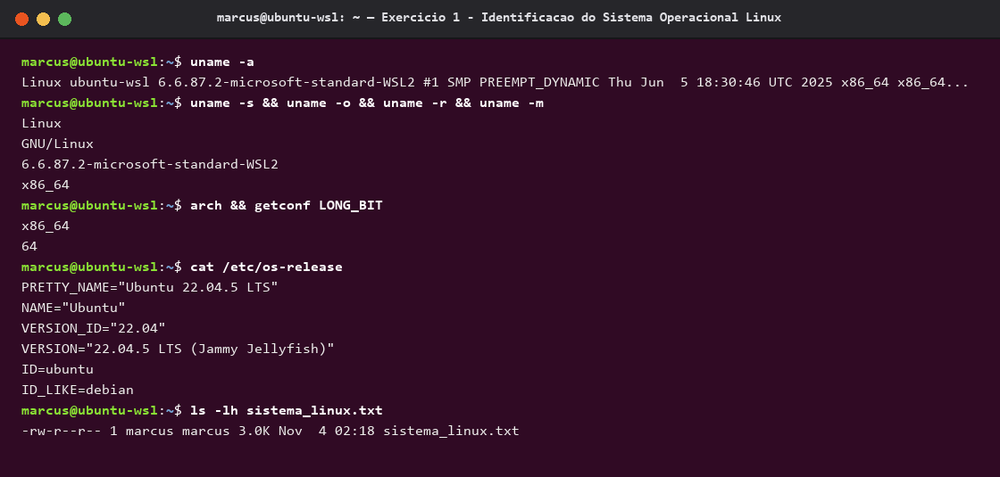

### Exercício 2 — Distribuições Linux e Contextos de Uso
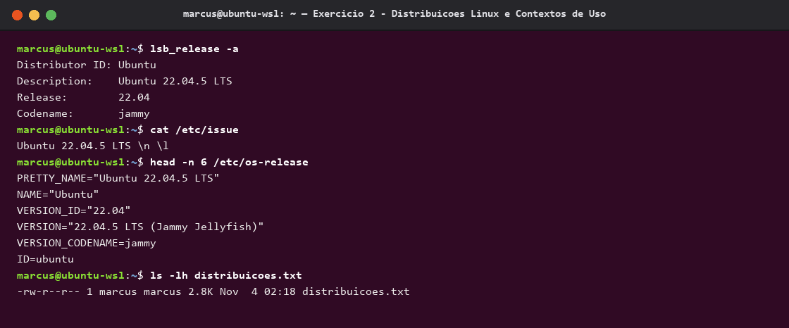

### Exercício 3 — Comandos Básicos (`date`, `cal`, `df`, `free`, `exit`)
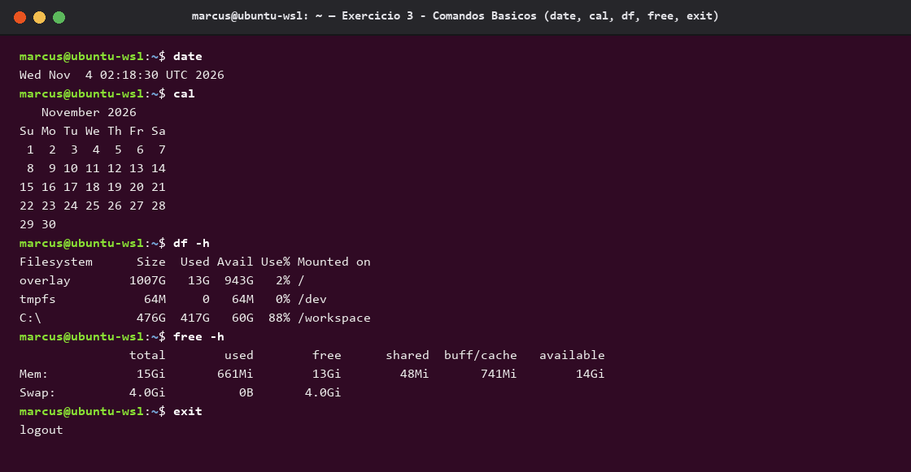

### Exercício 4 — Recursos Computacionais (CPU, Memória e Disco)
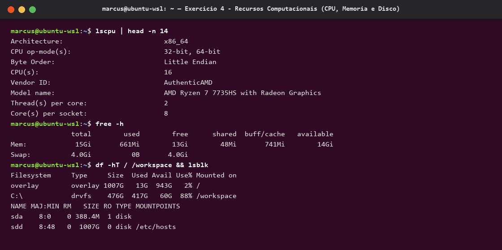

### Exercício 5 — Navegação pelo Sistema de Arquivos
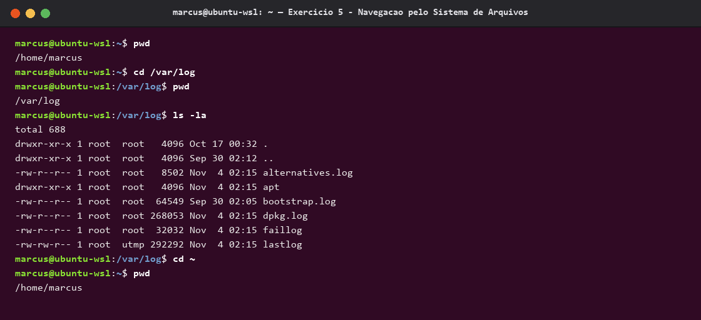

### Exercício 6 — Inspeção de Tipos de Arquivos e Visualização (`ls`, `file`, `less`)
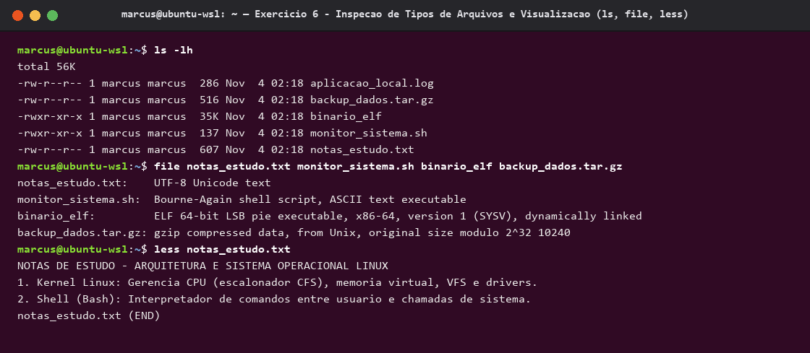

### Exercício 7 — Manipulação de Arquivos e Diretórios (`tp_linux`)
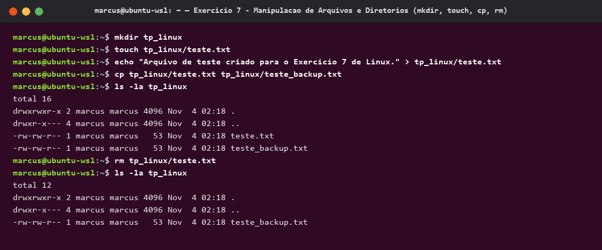

### Exercício 8 — Consulta à Documentação e Criação de Alias
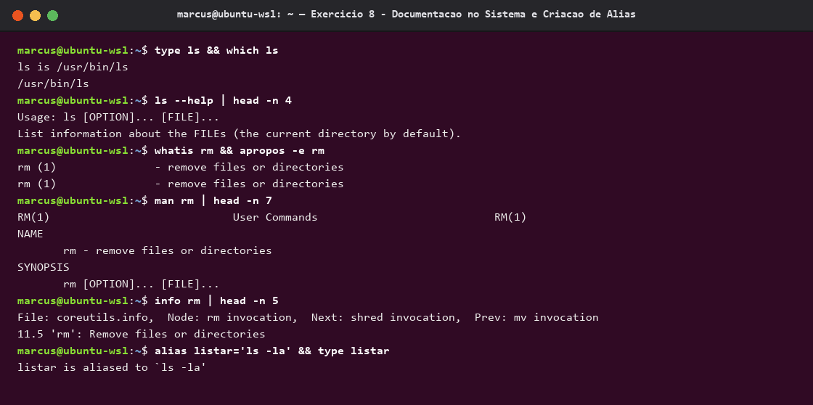

### Exercício 9 — Pipelines e Redirecionamento
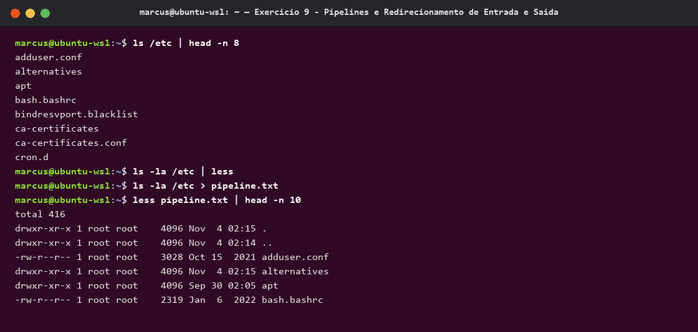

### Exercício 10 — Shell Expansions
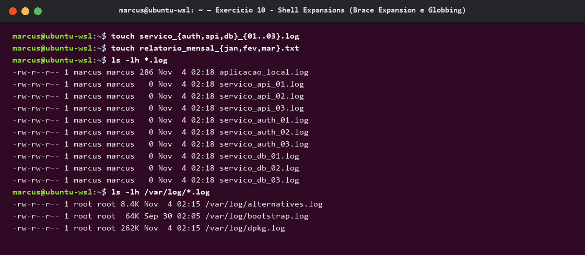

### Exercício 11 — Uso Correto de Aspas Simples e Duplas
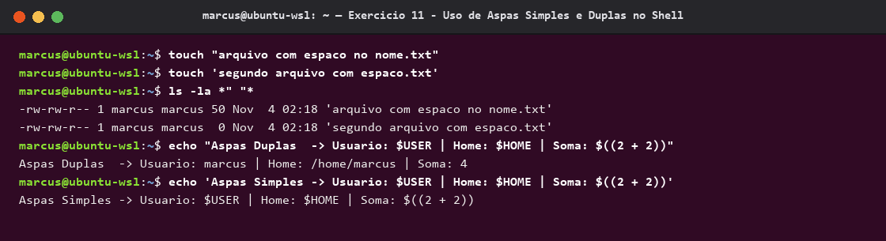

### Exercício 12 — Projeto Final (`projeto_final`)
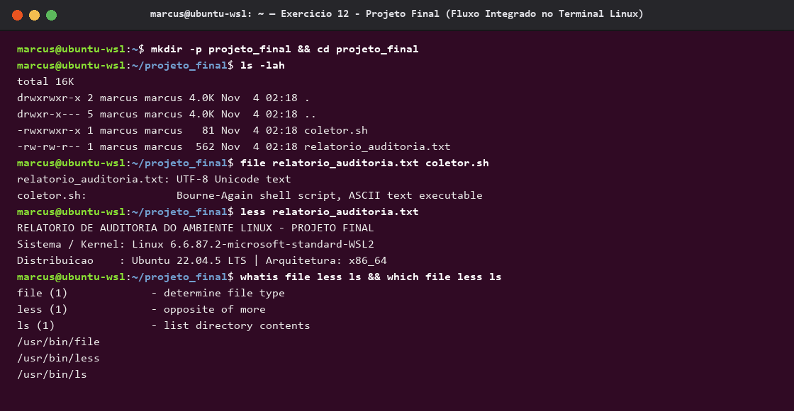

---

## 🛠️ Diretórios e Scripts Auxiliares

- [`tp_linux/`](./tp_linux/) — Diretório criado no **Exercício 7**, contendo o arquivo copiado [`teste_backup.txt`](./tp_linux/teste_backup.txt) após a remoção de `teste.txt`.
- [`projeto_final/`](./projeto_final/) — Diretório criado no **Exercício 12**, contendo o relatório de auditoria [`relatorio_auditoria.txt`](./projeto_final/relatorio_auditoria.txt) e o script [`coletor.sh`](./projeto_final/coletor.sh).
- [`run_exercises.sh`](./run_exercises.sh) — Script Bash para reprodução automatizada dos 12 exercícios em ambiente Linux.
- [`generate_screenshots_and_pdf.py`](./generate_screenshots_and_pdf.py) — Script Python para geração das capturas de tela e compilação do PDF consolidado.

---
Feito com dedicação para a disciplina de **Sistemas Operacionais com Linux e Python** 🎓
