# 🐧 Expansões, Pipelines, Dispositivos e Armazenamento no Linux - TP2

  
  
  
  

Este projeto corresponde à entrega do **Teste de Performance 2 (TP2)** da disciplina **Sistemas Operacionais com Linux e Python (`26E4_2`)** no **Instituto Infnet** (Bloco: *Ciência da Computação `[26E4-27E1]`*).

Contém a resolução prática dos **12 exercícios de linha de comando, inspeção de dispositivos, kernel e sistemas de arquivos no Linux**, acompanhada dos arquivos de evidência (`.txt`), dos registros separados de cada etapa da análise integrada (`analise_dispositivo/`) e das capturas de tela do terminal (`screenshots/`).

---

## 🗂️ Índice dos Exercícios, Evidências (`.txt`) e Screenshots

| Exercício | Tema Abordado | Arquivo de Evidência (`.txt`) | Screenshot do Terminal |
| :--- | :--- | :--- | :--- |
| **Exercício 01** | Shell expansions (`*.log`, brace expansion `{...}`) | [`expansoes.txt`](./expansoes.txt) | [`screenshots/exercicio_01.png`](./screenshots/exercicio_01.png) |
| **Exercício 02** | Pipelines e redirecionamento básico (`/etc`, `less`) | [`pipeline.txt`](./pipeline.txt) | [`screenshots/exercicio_02.png`](./screenshots/exercicio_02.png) |
| **Exercício 03** | Pipelines para inspeção de dispositivos de bloco (`/dev`) | [`dispositivos_bloco.txt`](./dispositivos_bloco.txt) | [`screenshots/exercicio_03.png`](./screenshots/exercicio_03.png) |
| **Exercício 04** | Redirecionamento e abstração de dispositivos (`/dev/null`) | [`redirecionamento.txt`](./redirecionamento.txt) | [`screenshots/exercicio_04.png`](./screenshots/exercicio_04.png) |
| **Exercício 05** | Uso correto de aspas simples (`'...'`) e duplas (`"..."`) | [`aspas.txt`](./aspas.txt) | [`screenshots/exercicio_05.png`](./screenshots/exercicio_05.png) |
| **Exercício 06** | Exploração do sysfs (`/sys/block` e atributos) | [`sysfs.txt`](./sysfs.txt) | [`screenshots/exercicio_06.png`](./screenshots/exercicio_06.png) |
| **Exercício 07** | Metadados de dispositivos com udev (`udevadm info`) | [`udev_info.txt`](./udev_info.txt) | [`screenshots/exercicio_07.png`](./screenshots/exercicio_07.png) |
| **Exercício 08** | Mensagens do kernel e hardware (`journalctl -k`) | [`kernel_devices.txt`](./kernel_devices.txt) | [`screenshots/exercicio_08.png`](./screenshots/exercicio_08.png) |
| **Exercício 09** | Dispositivos e drivers ativos (`/proc/devices`) | [`drivers.txt`](./drivers.txt) | [`screenshots/exercicio_09.png`](./screenshots/exercicio_09.png) |
| **Exercício 10** | Identificação de dispositivos de armazenamento (`lsblk`) | [`armazenamento.txt`](./armazenamento.txt) | [`screenshots/exercicio_10.png`](./screenshots/exercicio_10.png) |
| **Exercício 11** | Filesystems montados (`mount` e `df`) | [`filesystems.txt`](./filesystems.txt) | [`screenshots/exercicio_11.png`](./screenshots/exercicio_11.png) |
| **Exercício 12** | Integração de comandos para análise de dispositivo (`/dev/sde`) | [`analise_final.txt`](./analise_final.txt) | [`screenshots/exercicio_12.png`](./screenshots/exercicio_12.png) |

---

## 🖥️ Capturas de Tela da Execução no Terminal

### Exercício 1 — Shell Expansions
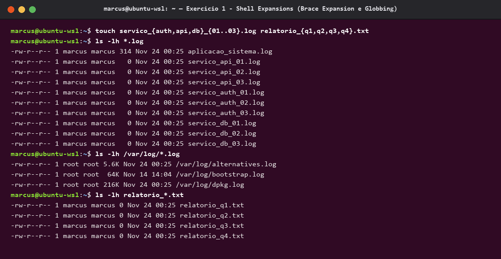

### Exercício 2 — Pipelines e Redirecionamento Básico
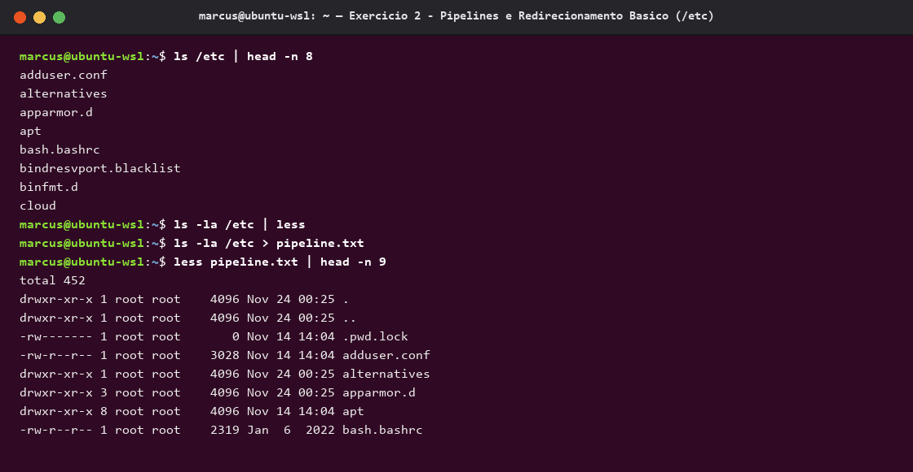

### Exercício 3 — Pipelines para Inspeção de Dispositivos de Bloco
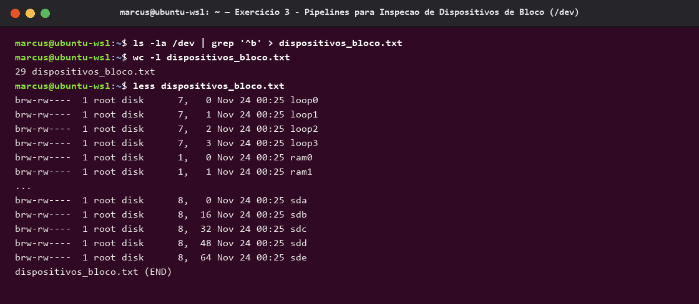

### Exercício 4 — Redirecionamento e Abstração de Dispositivos (`/dev/null`)
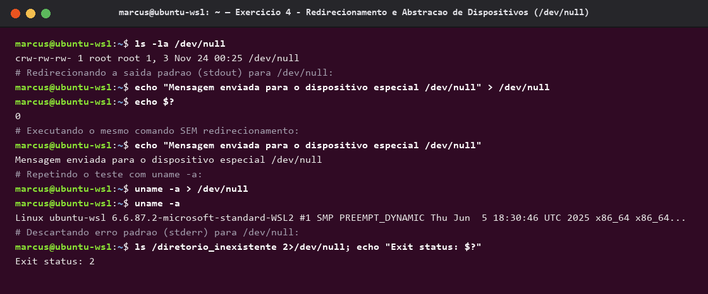

### Exercício 5 — Uso Correto de Aspas no Shell
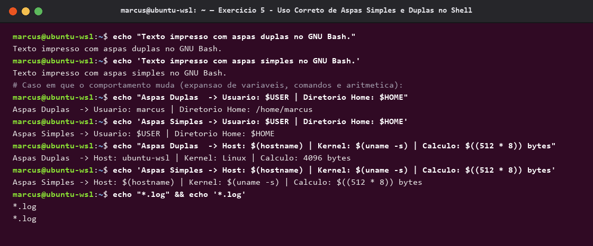

### Exercício 6 — Exploração do sysfs (`/sys/block`)
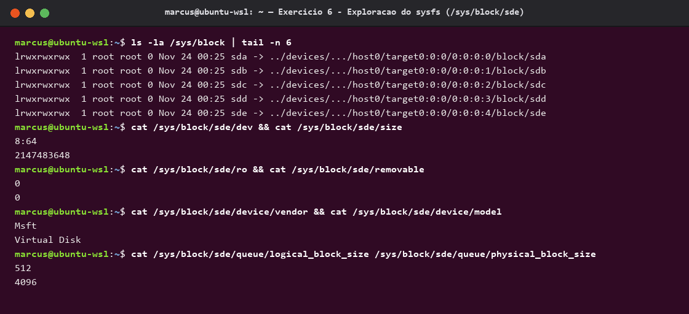

### Exercício 7 — Metadados de Dispositivos com udev (`udevadm info`)
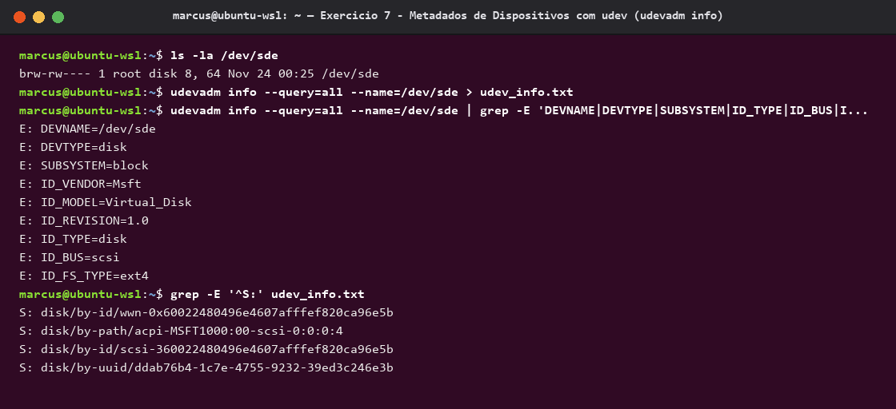

### Exercício 8 — Mensagens do Kernel e Hardware (`journalctl -k`)
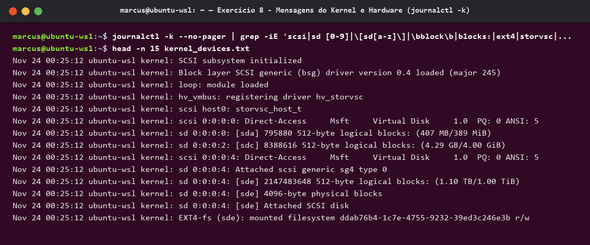

### Exercício 9 — Dispositivos e Drivers Ativos (`/proc/devices`)
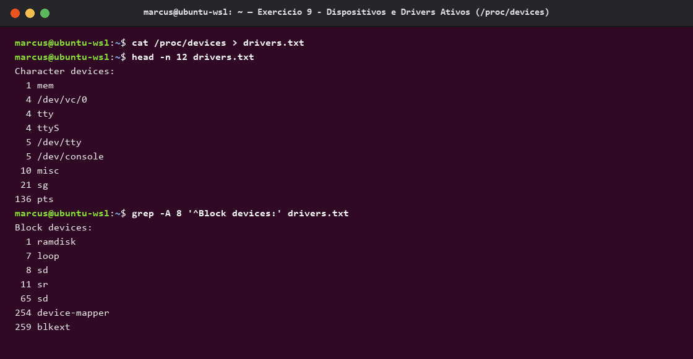

### Exercício 10 — Identificação de Dispositivos de Armazenamento (`lsblk`)
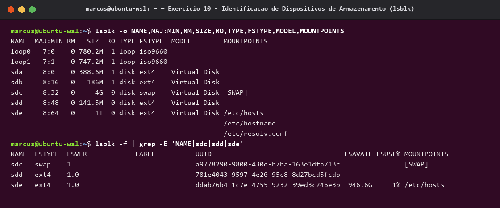

### Exercício 11 — Filesystems Montados (`mount` e `df`)
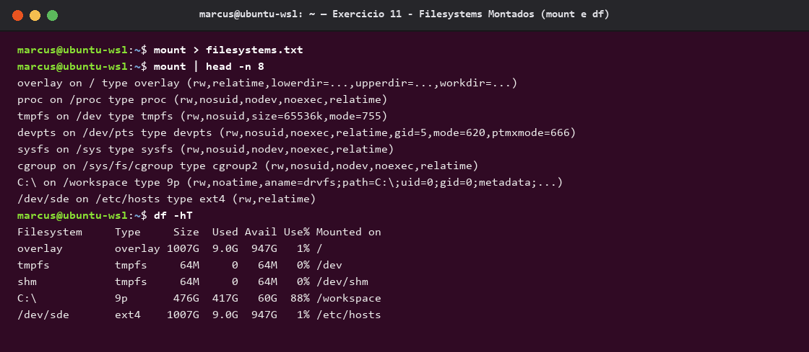

### Exercício 12 — Análise Integrada de Dispositivo de Armazenamento (`analise_final.txt`)
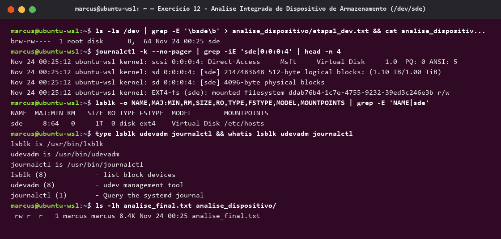

---

## 🛠️ Diretórios e Scripts Auxiliares

- [`analise_dispositivo/`](./analise_dispositivo/) — Diretório gerado no **Exercício 12** contendo os registros individuais por redirecionamento de cada etapa da análise do dispositivo `/dev/sde`:
  - [`etapa1_dev.txt`](./analise_dispositivo/etapa1_dev.txt) — Representação no diretório `/dev` e links persistentes `/dev/disk/by-*`.
  - [`etapa2_kernel_particoes.txt`](./analise_dispositivo/etapa2_kernel_particoes.txt) — Reconhecimento pelo kernel (`journalctl -k`), `/proc/partitions` e metadados `udevadm info`.
  - [`etapa3_hierarquia_bloco.txt`](./analise_dispositivo/etapa3_hierarquia_bloco.txt) — Hierarquia de block devices (`lsblk`), atributos do `sysfs` (`/sys/block/sde`) e montagem (`mount`).
  - [`etapa4_comando_auxiliar.txt`](./analise_dispositivo/etapa4_comando_auxiliar.txt) — Investigação dos utilitários utilizados via `type`, `which`, `whatis` e `man`.
- [`run_exercises.sh`](./run_exercises.sh) — Script Bash para reprodução automatizada dos 12 exercícios em ambiente Linux.

---
Feito com dedicação para a disciplina de **Sistemas Operacionais com Linux e Python** 🎓
