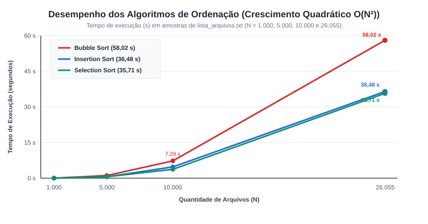
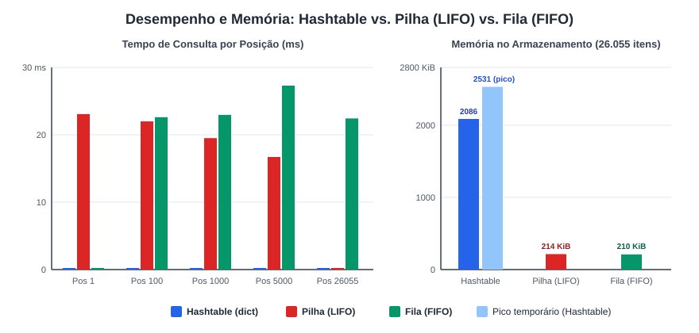

# Relatório Técnico — Manipulação de Arquivos em Linux, Algoritmos de Ordenação e Estruturas de Dados

## 1. Parte 1 — Manipulação de Arquivos em Linux

### 1.1 Procedimento Executado
A partir de um terminal Linux (ambiente em contêiner baseado em Alpine Linux `postgres:17-alpine`), acessou-se o diretório raiz (`/`) para gerar a listagem recursiva completa de todos os arquivos regulares presentes na raiz e em seus subdiretórios aninhados, redirecionando a saída padrão para `lista_arquivos.txt` e descartando mensagens de erro de permissão/descritores inacessíveis (`2>/dev/null`):

```sh
cd /
find / -type f 2>/dev/null > /tmp/lista_arquivos.txt
mv /tmp/lista_arquivos.txt /work/lista_arquivos.txt
wc -l /work/lista_arquivos.txt
```

Para inspeção e desenvolvimento por linha de comando em ambiente não gráfico no Linux, utilizam-se utilitários padrão de terminal (`wc`, `head`, `tail`, `ls`) e editores de texto de terminal (`nano` ou `vi`/`vim`):

```sh
nano programa1_ordenacao.py
nano programa2_estruturas.py
```

### 1.2 Print de Execução (Terminal Linux)

```text
/
-rw-r--r--    1 root     root        1.4M Nov 15 14:56 /work/lista_arquivos.txt
26055 /work/lista_arquivos.txt
/sys/kernel/warn_count
/sys/kernel/notes
/sys/kernel/mm/hugepages/hugepages-2048kB/free_hugepages
/sys/kernel/mm/hugepages/hugepages-2048kB/resv_hugepages
/sys/kernel/mm/hugepages/hugepages-2048kB/surplus_hugepages
/etc/group-
/etc/passwd-
/etc/shadow-
/work/lista_arquivos.txt
/.dockerenv
```

O arquivo gerado ([lista_arquivos.txt](lista_arquivos.txt)) contém **26.055 caminhos de arquivos** (1,4 MiB), atendendo com folga ao requisito mínimo de 10.000 arquivos.

---

## 2. Parte 2 — Lógica e Funcionamento dos Programas em Python

### 2.1 Programa 1: `programa1_ordenacao.py`

O arquivo [programa1_ordenacao.py](programa1_ordenacao.py) lê todas as linhas não vazias de `lista_arquivos.txt` para uma lista de strings em memória (`carregar_arquivos`) e executa três algoritmos de ordenação clássicos sobre cópias idênticas da entrada (`itens.copy()`), garantindo que todos partam exatamente do mesmo estado inicial:

1. **Bubble Sort (`bubble_sort`)**: percorre repetidamente o vetor comparando pares adjacentes (`dados[j] > dados[j + 1]`) e trocando-os quando estão fora de ordem. A cada passagem externa, o maior elemento restante "borbulha" para a posição final correta. Inclui a flag `trocou` para encerramento antecipado caso uma passagem inteira ocorra sem trocas.
2. **Selection Sort (`selection_sort`)**: divide logicamente a lista em uma porção ordenada (à esquerda) e outra não ordenada (à direita). Em cada iteração `i`, busca o índice do menor elemento no intervalo `[i, N - 1]` e realiza no máximo **uma troca** ao final da varredura interna (`dados[i], dados[indice_menor] = ...`).
3. **Insertion Sort (`insertion_sort`)**: constrói a sequência ordenada incrementalmente da esquerda para a direita. Para cada elemento `chave = dados[i]`, desloca para a direita os elementos anteriores maiores do que `chave` e insere `chave` na posição correta.

Cada execução é cronometrada com `time.perf_counter()` (relógio monotônico de alta resolução), contabilizando também o número exato de comparações e de trocas/deslocamentos, além de validar que a saída de todos os algoritmos coincide com `sorted(dados)`. Com a flag `--escala`, o programa também mede subconjuntos de tamanho `N = 1.000`, `5.000` e `10.000` antes da listagem completa (`26.055`).

#### Print de Execução (`python programa1_ordenacao.py --escala`)

```text
Arquivo carregado: lista_arquivos.txt
Total de registros lidos: 26,055

=== Benchmark de Escala (Amostras) ===
Algoritmo        |       N |   Tempo (s) |    Comparações | Trocas/Desloc.
--------------------------------------------------------------------------
Bubble Sort      |    1000 |    0.040841 |        493,935 |        170,369
Selection Sort   |    1000 |    0.023549 |        499,500 |            983
Insertion Sort   |    1000 |    0.017971 |        171,361 |        170,369
Bubble Sort      |    5000 |    1.123074 |     12,296,839 |      5,814,329
Selection Sort   |    5000 |    0.598462 |     12,497,500 |          4,985
Insertion Sort   |    5000 |    0.573759 |      5,819,321 |      5,814,329
Bubble Sort      |   10000 |    7.285174 |     49,815,899 |     31,862,584
Selection Sort   |   10000 |    3.739346 |     49,995,000 |          9,986
Insertion Sort   |   10000 |    4.753777 |     31,872,571 |     31,862,584

=== Ordenação Completa (26,055 arquivos) ===
Algoritmo        |       N |   Tempo (s) |    Comparações | Trocas/Desloc.
--------------------------------------------------------------------------
Bubble Sort      |   26055 |   58.019242 |    339,418,485 |    196,303,504
Selection Sort   |   26055 |   35.709156 |    339,418,485 |         26,026
Insertion Sort   |   26055 |   36.475584 |    196,329,505 |    196,303,504

Amostra dos 5 primeiros após ordenação:
  1: /.dockerenv
  2: /bin/bash
  3: /bin/busybox
  4: /etc/alpine-release
  5: /etc/apk/arch
Amostra dos 5 últimos após ordenação:
  26051: /usr/share/zoneinfo/posixrules
  26052: /usr/share/zoneinfo/zone.tab
  26053: /usr/share/zoneinfo/zone1970.tab
  26054: /var/log/apk.log
  26055: /work/lista_arquivos.txt
```

---

### 2.2 Programa 2: `programa2_estruturas.py`

O arquivo [programa2_estruturas.py](programa2_estruturas.py) carrega os 26.055 caminhos e executa o mesmo ciclo de testes em três estruturas implementadas com suas disciplinas próprias de acesso:

1. **Hashtable (`TabelaHash`, baseada em `dict`)**: armazena os caminhos indexados pela posição 1-based (`1..N`). A consulta por posição (`obter_posicao`) faz acesso direto pela chave em $O(1)$. Adição e remoção operam diretamente por chave na tabela hash.
2. **Pilha (`Pilha`, baseada em `list`, disciplina LIFO)**: itens são inseridos com `empilhar` (`append`) e removidos pelo topo com `desempilhar` (`pop`). Como a pilha restringe o acesso ao topo (posição `N`, última da listagem), consultar uma posição interna `p` exige desempilhar `N - p` elementos para uma pilha auxiliar, ler o topo e reempilhar os elementos preservando o estado original.
3. **Fila (`Fila`, baseada em `collections.deque`, disciplina FIFO)**: itens são inseridos no fim (`enfileirar` / `append`) e removidos da frente (`desenfileirar` / `popleft`). A primeira posição (`1`) encontra-se na frente em $O(1)$; para consultar qualquer outra posição mantendo a ordem intacta, o algoritmo rotaciona os `N` itens da fila retirando da frente e reinserindo ao final.

Em cada operação — armazenamento completo (`26.055` itens), consultas individuais nas posições `1`, `100`, `1.000`, `5.000` e `26.055` (última), além de adição em lote (`1.000` itens) e remoção em lote (`1.000` itens) — são registrados:
- **Tempo de execução** via `time.perf_counter()` (em milissegundos);
- **Variação líquida de memória (`Delta Mem`)** e **pico adicional durante a execução (`Pico Mem`)** via `tracemalloc` (com `gc.collect()` prévio para isolar cada etapa).

#### Print de Execução (`python programa2_estruturas.py`)

```text
Arquivo carregado: lista_arquivos.txt
Total de registros lidos: 26,055
Tamanho do lote de adição/remoção: 1,000 itens

=== Arquivos Recuperados (Consistentes nas 3 Estruturas) ===
  Primeira (1)    : /sys/kernel/warn_count
  Posição 100     : /sys/kernel/slab/task_delay_info/reclaim_account
  Posição 1000    : /sys/kernel/slab/xfs_attrd_item/hwcache_align
  Posição 5000    : /sys/kernel/slab/kmalloc-rcl-2k/reclaim_account
  Última (26055)  : /.dockerenv

=== Métricas de Tempo e Memória por Estrutura ===
Estrutura       | Operação                       |  Tempo (ms) | Delta Mem (KiB) | Pico Mem (KiB)
-------------------------------------------------------------------------------------------------
Hashtable       | Armazenamento (26,055 itens)   |     12.5606 |         2086.45 |        2530.91
Hashtable       | Consulta pos 1                 |      0.0112 |            0.18 |           0.18
Hashtable       | Consulta pos 100               |      0.0020 |            0.18 |           0.18
Hashtable       | Consulta pos 1000              |      0.0016 |            0.18 |           0.18
Hashtable       | Consulta pos 5000              |      0.0055 |            0.18 |           0.18
Hashtable       | Consulta pos 26055             |      0.0047 |            0.18 |           0.18
Hashtable       | Adição (1,000 itens)           |      0.4499 |           31.43 |          31.43
Hashtable       | Remoção (1,000 itens)          |      0.7710 |          -31.07 |           0.29
Pilha (LIFO)    | Armazenamento (26,055 itens)   |      3.9334 |          214.05 |         214.05
Pilha (LIFO)    | Consulta pos 1                 |     23.0724 |            0.23 |         105.62
Pilha (LIFO)    | Consulta pos 100               |     21.9896 |            6.70 |         108.78
Pilha (LIFO)    | Consulta pos 1000              |     19.5066 |           -4.52 |          99.96
Pilha (LIFO)    | Consulta pos 5000              |     16.7071 |            7.02 |         105.62
Pilha (LIFO)    | Consulta pos 26055             |      0.0047 |            0.18 |           0.18
Pilha (LIFO)    | Adição (1,000 itens)           |      0.0835 |            0.18 |           0.18
Pilha (LIFO)    | Remoção (1,000 itens)          |      0.3171 |            0.18 |           0.29
Fila (FIFO)     | Armazenamento (26,055 itens)   |      2.4094 |          210.04 |         210.04
Fila (FIFO)     | Consulta pos 1                 |      0.0087 |            0.18 |           0.18
Fila (FIFO)     | Consulta pos 100               |     22.6113 |            0.70 |           0.77
Fila (FIFO)     | Consulta pos 1000              |     22.9550 |            0.18 |           0.32
Fila (FIFO)     | Consulta pos 5000              |     27.2918 |            0.18 |           0.32
Fila (FIFO)     | Consulta pos 26055             |     22.4248 |            0.18 |           0.32
Fila (FIFO)     | Adição (1,000 itens)           |      0.0954 |            7.91 |           7.91
Fila (FIFO)     | Remoção (1,000 itens)          |      0.4504 |            0.18 |           0.29
```

---

## 3. Parte 3 — Análise Teórica (Big O) e Comparação Prática

### 3.1 Algoritmos de Ordenação

#### Complexidade Teórica (Notação Big O)

| Algoritmo | Melhor Caso | Caso Médio | Pior Caso | Espaço Auxiliar | Estável |
| :--- | :---: | :---: | :---: | :---: | :---: |
| **Bubble Sort** | $O(N)$ (com flag `trocou`) | $O(N^2)$ | $O(N^2)$ | $O(1)$ | Sim |
| **Selection Sort** | $O(N^2)$ | $O(N^2)$ | $O(N^2)$ | $O(1)$ | Não |
| **Insertion Sort** | $O(N)$ | $O(N^2)$ | $O(N^2)$ | $O(1)$ | Sim |

*Obs.: nos testes, os algoritmos operam sobre uma cópia da lista de entrada (`O(N)`) apenas para preservar os dados originais entre execuções.*

#### Resultados Observados vs. Teoria

| $N$ | Bubble Sort (s) | Selection Sort (s) | Insertion Sort (s) | Razão de tempo ($N=5000 / N=1000$, teórico $25\times$) |
| :---: | :---: | :---: | :---: | :---: |
| **1.000** | 0,040841 | 0,023549 | 0,017971 | — |
| **5.000** | 1,123074 | 0,598462 | 0,573759 | 27,5× / 25,4× / 31,9× |
| **10.000** | 7,285174 | 3,739346 | 4,753777 | — |
| **26.055** | 58,019242 | 35,709156 | 36,475584 | — |



**Interpretação dos resultados:**
1. **Confirmação do crescimento quadrático $O(N^2)$**: ao multiplicar a entrada por 5 (de $N = 1.000$ para $N = 5.000$), o crescimento teórico esperado para funções $O(N^2)$ é $5^2 = 25\times$. Na prática, o Selection Sort cresceu exatamente **25,4×** (passando de 499.500 para 12.497.500 comparações, uma vez que $\frac{N(N-1)}{2}$ independe da ordem dos dados). Da mesma forma, de $N = 5.000$ para $N = 26.055$ (fator $5{,}211\times$, teórico $27{,}15\times$), as comparações do Selection Sort aumentaram de 12.497.500 para 339.418.485 (**27,16×**).
2. **Por que Bubble Sort foi o mais lento (58,02 s)?** Em $N = 26.055$, Bubble Sort e Selection Sort executaram exatamente o mesmo número de comparações (**339.418.485**, pois o maior ou último elemento fora de ordem impediu parada antecipada relevante no Bubble Sort). Porém, enquanto o Selection Sort realizou apenas **26.026 trocas** ($O(N)$ escritas em memória), o Bubble Sort executou **196.303.504 trocas** ($O(N^2)$ escritas em memória). O custo de milhões de atribuições na lista explica a diferença de ~22,3 segundos entre ambos.
3. **Inversão de liderança entre Insertion Sort e Selection Sort**: em $N = 1.000$ (arquivos apenas de `/sys/kernel/...`), a amostra possuía menos inversões (~34% do máximo), permitindo ao Insertion Sort fazer apenas 171.361 comparações e vencer com **0,018 s**. Conforme $N$ avançou para `10.000` e `26.055`, o comando `find /` passou a listar caminhos em `/proc`, `/usr`, `/lib` e `/etc` *depois* de `/sys` — caminhos alfabeticamente menores que `/sys`, elevando o total de inversões para **196.303.504** (~57,8% do máximo $\frac{N(N-1)}{2}$). Como cada inversão exige um deslocamento no laço interno do Insertion Sort, ele acabou empatando tecnicamente com o Selection Sort em $N = 26.055$ (**36,48 s** vs. **35,71 s**), apesar de realizar 42% menos comparações.

---

### 3.2 Estruturas de Dados: Hashtable, Pilha e Fila

#### Complexidade Teórica (Notação Big O)

| Operação | Hashtable (`dict`) | Pilha (`list`, LIFO) | Fila (`deque`, FIFO) |
| :--- | :---: | :---: | :---: |
| Inserir 1 item | $O(1)$ amortizado | $O(1)$ amortizado | $O(1)$ |
| Carga completa ($N$ itens) | $O(N)$ | $O(N)$ | $O(N)$ |
| Consultar posição 1 | $O(1)$ | $O(N)$ (fundo da pilha) | $O(1)$ (frente da fila) |
| Consultar posição $N$ (última) | $O(1)$ | $O(1)$ (topo da pilha) | $O(N)$ (fim da fila) |
| Consultar posição arbitrária $k$ | $O(1)$ | $O(N - k + 1) \Rightarrow O(N)$ | $O(N)$ (rotação preservando ordem) |
| Remover 1 item (regra da estrutura) | $O(1)$ amortizado | $O(1)$ (topo) | $O(1)$ (frente) |
| Espaço adicional de consulta | $O(1)$ | $O(N)$ (pilha auxiliar) | $O(1)$ (rotação in-place) |



#### Análise Comparativa de Tempo e Memória Observados

1. **Armazenamento dos 26.055 arquivos (Tempo e Memória)**:
   - **Hashtable (`12,56 ms` | `2.086,45 KiB` líquidos | `2.530,91 KiB` pico)**: consumiu cerca de **10× mais memória** e foi de 5× a 8× mais lenta na carga inicial que Pilha e Fila. Isso decorre da arquitetura interna de tabelas hash abertas em Python (`dict`): além de alocar 26.055 objetos `int` para as chaves, o `dict` mantém um vetor esparso com fator de carga limitado (redimensionando em potências de 2), armazenando hash, ponteiro de chave e ponteiro de valor por entrada. O pico transitório de `2.530,91 KiB` ocorre exatamente durante o último redimensionamento (*rehash*) antes de liberar a tabela antiga.
   - **Pilha (`3,93 ms` | `214,05 KiB`)** e **Fila (`2,41 ms` | `210,04 KiB`)**: armazenam apenas as referências (ponteiros de 8 bytes em arquiteturas 64 bits) às strings já carregadas ($26.055 \times 8\text{ B} \approx 203{,}5\text{ KiB}$), com sobrecarga mínima de controle. A `deque` evitou realocações contíguas de bloco único por organizar os itens em blocos encadeados de tamanho fixo.

2. **Consultas nas posições 1, 100, 1.000, 5.000 e 26.055**:
   - **Hashtable**: manteve tempo constante $O(1)$ em todas as posições (**0,0016 ms a 0,0112 ms**), sem qualquer alocação extra de memória (`0,18 KiB` apenas dos objetos temporários de medição).
   - **Pilha (LIFO)**: apenas a última posição (`26.055`, topo) respondeu em $O(1)$ (**0,0047 ms**). As demais cresceram linearmente conforme a distância até o topo: `16,71 ms` (pos. 5.000), `19,51 ms` (pos. 1.000), `21,99 ms` (pos. 100) até **23,07 ms** na posição `1` (fundo da pilha). Além disso, a necessidade de uma pilha auxiliar gerou um **pico transitório de ~100 a 109 KiB** em cada consulta profunda.
   - **Fila (FIFO)**: comportamento espelhado — a posição `1` (frente) foi imediata em $O(1)$ (**0,0087 ms**), enquanto as posições `100`, `1.000`, `5.000` e `26.055` exigiram rotação completa dos 26.055 itens (**22,42 ms a 27,29 ms**, $O(N)$), porém mantendo memória auxiliar $O(1)$ (pico de apenas `0,32–0,77 KiB`).

3. **Adição e Remoção em Lote (1.000 itens)**:
   - Todas as três estruturas executaram 1.000 adições e 1.000 remoções em menos de **1 ms** (`0,08 ms` a `0,77 ms`), confirmando complexidade $O(1)$ por operação individual.
   - Em memória, a **Hashtable** alocou **+31,43 KiB** na adição (novos pares chave inteira/valor) e liberou imediatamente **-31,07 KiB** ao remover as 1.000 chaves; a **Fila (`deque`)** alocou **+7,91 KiB** de novos blocos na adição; e a **Pilha (`list`)** apresentou variação de apenas **0,18 KiB**, pois seu buffer contíguo já possuía capacidade pré-alocada suficiente após as operações anteriores de consulta.

---

## 4. Conclusão

- Para **ordenação** de grandes volumes de texto (26.055 linhas), algoritmos $O(N^2)$ como Bubble Sort (`58,02 s`), Insertion Sort (`36,48 s`) e Selection Sort (`35,71 s`) tornam-se rapidamente custosos na prática, evidenciando a importância de algoritmos $O(N \log N)$ (como Timsort, usado internamente pelo `sorted()` do Python) em cenários reais. Entre os três quadráticos, o número reduzido de escritas $O(N)$ deu vantagem ao Selection Sort quando há alto grau de desordem.
- Para **armazenamento e acesso**, observou-se o clássico compromisso (*trade-off*) entre **tempo e memória**: a **Hashtable** consome ~10× mais memória (`~2,0 MiB` vs. `~210 KiB`), mas garante acesso aleatório em $O(1)$ (`~0,002–0,011 ms`). Já **Pilha** e **Fila** são extremamente compactas e velozes nas extremidades (`O(1)` no topo para Pilha e na frente para Fila), mas penalizam consultas posicionais arbitrárias com custo linear $O(N)$ (`~16–27 ms`).

